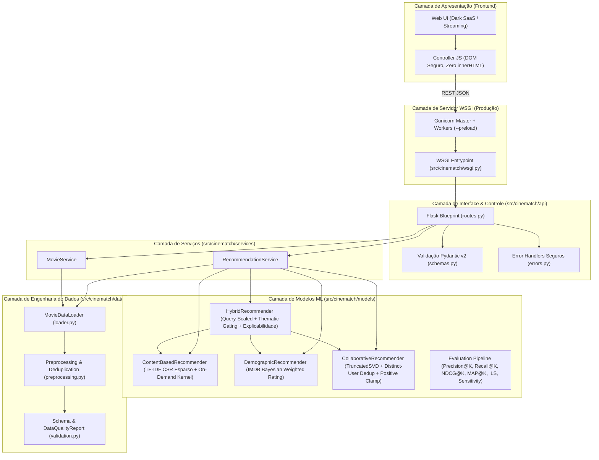

# Arquitetura de Software e Machine Learning — CineMatch (v2.1.0)

## 1. Visão Geral

O **CineMatch (`cinematch-recommender` v2.1.0)** é um motor híbrido de recomendação de filmes projetado segundo os princípios **SOLID, Clean Architecture, separação estrita de responsabilidades e eficiência computacional em matrizes esparsas**.

A aplicação utiliza uma arquitetura modular em camadas sob o pacote `src/cinematch/`, permitindo:
- Escalabilidade de memória de $O(N^2)$ (**3,2 GB – 16,5 GB**) para $O(\text{nnz})$ (**12,3 MB** na matriz esparsa TF-IDF para 45.430 filmes) e compartilhamento *zero-copy* do `movies_df` entre serviços e modelos (`624,1 MiB` totais no container Docker com 2 workers sob carga).
- Execução em produção via servidor WSGI **Gunicorn (`cinematch.wsgi:app`)** com `--preload` e singleton thread-safe por processo (`get_wsgi_app()`), compartilhando o catálogo e as matrizes via *Copy-on-Write (CoW)*.
- Injeção de dependências via *Application Factory* (`create_app`), eliminando estado global mutável em tempo de importação.
- Combinação ponderada calibrada por consulta e com *gating* temático entre **Content-Based Filtering**, **Demographic Filtering** e **Collaborative Filtering** (ativado opcionalmente com MovieLens `ml-latest-small`), com explicabilidade em linguagem natural.

---

## 2. Diagrama de Arquitetura em Camadas

---

## 3. Componentes e Responsabilidades

### 3.1. `src/cinematch/config.py` & `src/cinematch/wsgi.py`
- **`config.py`**: Centraliza todas as configurações na `dataclass` imutável `AppConfig`, carregada de variáveis de ambiente (`.env`) com validação explícita (`validate()`), bloqueando `debug=True` quando `CINEMATCH_ENV=production`, restringindo origens de CORS e padronizando o caminho do dataset em `data/movies_metadata.csv`.
- **`wsgi.py`**: Expõe o singleton WSGI `app` / `get_wsgi_app()` protegido por lock de thread/processo (`_WSGI_LOCK`), garantindo que o servidor Gunicorn inicialize os modelos uma única vez por processo sem acionar o servidor de desenvolvimento do Flask (`app.run()`).

### 3.2. `src/cinematch/data/`
- **`validation.py`**: Valida a presença das colunas obrigatórias (`title`, `overview`, `vote_average`, `vote_count`, `release_date`) e define o modelo `DataQualityReport`.
- **`preprocessing.py`**:
  - Coerção segura de identificadores numéricos (`movie_id`), removendo registros corrompidos do CSV original.
  - Deduplicação determinística por `movie_id` preservando o registro com maior `vote_count`.
  - Extração segura de listas e dicionários serializados (`genres_list`, `collection_name`, `production_list`) via `ast.literal_eval`.
  - Higienização de `poster_path` contra URLs externas arbitrárias.
  - Normalização unicode/alfanumérica de títulos (`normalize_title`) para busca resiliente e tratamento de títulos duplicados.
  - Amostragem aleatória reproduzível com `random_state` configurável quando `sample_size` é especificado.
- **`loader.py`**: `MovieDataLoader` verifica existência, tipo de arquivo (prevenindo diretórios montados incorretamente pelo Docker), tamanho não nulo (`> 0 bytes`) e permissões de leitura (`PermissionError`), além de carregar e deduplicar o arquivo opcional de avaliações (`ratings.csv`).

### 3.3. `src/cinematch/models/`
- **`demographic.py` (`DemographicRecommender`)**: Implementação vetorizada da fórmula bayesiana do IMDB:
  $$\text{WR} = \frac{v}{v+m} R + \frac{m}{v+m} C$$
- **`content_based.py` (`ContentBasedRecommender`)**:
  - Constrói documentos ponderados usando tokens prefixados por namespace (`genre_*`, `collection_*`, `studio_*`, `lang_*`) combinados com texto livre de `overview` e `tagline`.
  - Armazena exclusivamente a matriz esparsa `scipy.sparse.csr_matrix` (`float32`), ocupando ~12,3 MB para 45.430 filmes.
  - Calcula a similaridade de cosseno sob demanda apenas para a linha do filme consultado: `linear_kernel(tfidf_matrix[idx : idx + 1], tfidf_matrix)`.
- **`collaborative.py` (`CollaborativeRecommender`)**:
  - Valida `user_id`/`userId`, `movie_id`/`movieId` e `rating`, deduplicando múltiplas avaliações do mesmo usuário para o mesmo filme (mantendo a avaliação mais recente por `timestamp` quando disponível, ou a última ocorrência válida).
  - Contabiliza cobertura estritamente por **usuários distintos (`nunique`)**, impedindo que linhas duplicadas inflem `min_interactions`.
  - Trunca similaridades de cosseno não positivas em zero ($\max(0.0, \cos(\mathbf{f}_q, \mathbf{f}_i))$), garantindo que correlação nula ou negativa jamais gere evidência positiva artificial.
  - Trata explicitamente o *Cold-Start Problem*: sem interações reais, permanece em *standby* sem inventar avaliações.
- **`hybrid.py` (`HybridRecommender`)**:
  - Aplica **calibração de escala relativa à consulta** ($\tilde{S}_c(q, i) = S_c(q, i) / \max_{j \neq q} S_c(q, j)$) e **gating de relevância temática**, impedindo que blockbusters globais com similaridade temática zero dominem recomendações personalizadas apenas pelo score demográfico.
  - Renormaliza os pesos automaticamente quando o componente colaborativo está em standby e gera explicações factuais em português.
- **`evaluation.py`**: Pipeline quantitativo reproduzível com protocolo anti-leakage (holdout de `collection_name` + verificação explícita de interseção de gênero) e análise de sensibilidade dos pesos híbridos.
