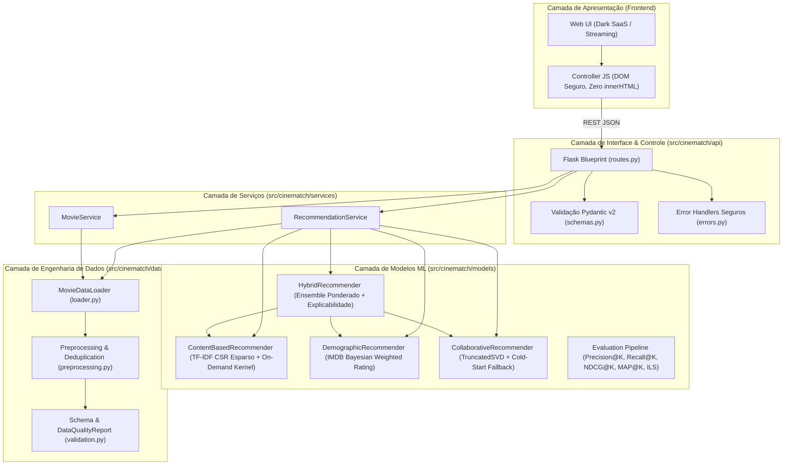

# Arquitetura de Software e Machine Learning — CineMatch

## 1. Visão Geral

O **CineMatch (`cinematch-recommender`)** é um motor híbrido de recomendação de filmes projetado segundo os princípios **SOLID, Clean Architecture, separação estrita de responsabilidades e eficiência computacional em matrizes esparsas**.

A aplicação substitui o antigo protótipo monolítico por uma arquitetura modular em camadas sob o pacote `src/cinematch/`, permitindo:
- Escalabilidade de memória de $O(N^2)$ (**3,2 GB – 16,5 GB**) para $O(\text{nnz})$ (**12,3 MB** para 45.430 filmes).
- Injeção de dependências via *Application Factory* (`create_app`), eliminando estado global mutável em tempo de importação.
- Combinação ponderada dinâmica entre **Content-Based Filtering**, **Demographic Filtering** e **Collaborative Filtering** com explicabilidade automática em linguagem natural.

---

## 2. Diagrama de Arquitetura em Camadas

---

## 3. Componentes e Responsabilidades

### 3.1. `src/cinematch/config.py`
Centraliza todas as configurações da aplicação na `dataclass` imutável `AppConfig`, carregada a partir de variáveis de ambiente (`.env`) com validação explícita de invariantes (`validate()`), bloqueando o uso de `debug=True` quando `CINEMATCH_ENV=production` e restringindo origens de CORS.

### 3.2. `src/cinematch/data/`
- **`validation.py`**: Valida a presença das colunas obrigatórias (`title`, `overview`, `vote_average`, `vote_count`, `release_date`) e define o modelo `DataQualityReport`.
- **`preprocessing.py`**:
  - Coerção segura de identificadores numéricos (`movie_id`), removendo registros corrompidos do CSV original.
  - Deduplicação determinística por `movie_id` preservando o registro com maior `vote_count`.
  - Extração segura de listas e dicionários serializados (`genres_list`, `collection_name`, `production_list`) via `ast.literal_eval` controlado.
  - Higienização de `poster_path` contra URLs externas arbitrárias.
  - Normalização unicode/alfanumérica de títulos (`normalize_title`) para busca resiliente e tratamento de títulos duplicados.
  - Amostragem aleatória reproduzível com `random_state` configurável quando `sample_size` é especificado.
- **`loader.py`**: `MovieDataLoader` coordena a leitura do CSV principal e do arquivo opcional de avaliações de usuários (`ratings.csv`).

### 3.3. `src/cinematch/models/`
- **`demographic.py` (`DemographicRecommender`)**: Implementação vetorizada da fórmula bayesiana do IMDB:
  $$\text{WR} = \frac{v}{v+m} R + \frac{m}{v+m} C$$
  Produz tanto o score bruto quanto o score normalizado em $[0, 1]$ para fusão no motor híbrido.
- **`content_based.py` (`ContentBasedRecommender`)**:
  - Constrói documentos ponderados usando tokens prefixados por namespace (`genre_*`, `collection_*`, `studio_*`, `lang_*`) combinados com texto livre de `overview` e `tagline`.
  - Armazena exclusivamente a matriz esparsa `scipy.sparse.csr_matrix` (`float32`), ocupando ~12,3 MB para 45.430 filmes.
  - Calcula a similaridade de cosseno sob demanda apenas para a linha do filme consultado: `linear_kernel(tfidf_matrix[idx : idx + 1], tfidf_matrix)`.
- **`collaborative.py` (`CollaborativeRecommender`)**:
  - Opera sobre interações reais usuário-item (`user_id`, `movie_id`, `rating`), aplicando centralização pela média do usuário e fatoração matricial esparsa via `TruncatedSVD`.
  - Trata explicitamente o *Cold-Start Problem*: caso o dataset de avaliações não esteja presente ou o filme consultado não possua histórico suficiente, sinaliza `has_item(movie_id) == False` sem jamais sintetizar avaliações fictícias.
- **`hybrid.py` (`HybridRecommender`)**:
  - Combina os scores normalizados dos componentes ativos e renormaliza os pesos automaticamente quando o componente colaborativo está em standby.
  - Gera explicações factuais em português baseadas nos atributos reais compartilhados (franquia, similaridade temática, gêneros em comum, estúdio e avaliação ponderada).
- **`evaluation.py`**: Pipeline quantitativo com protocolo anti-leakage (`Precision@K`, `Recall@K`, `NDCG@K`, `MAP@K`, `Catalog Coverage`, `Intra-List Similarity` e `Recommendation Diversity`).

### 3.4. `src/cinematch/services/` e `src/cinematch/api/`
- **`MovieService`** e **`RecommendationService`** encapsulam a lógica de negócio, paginação e serialização.
- **`routes.py`**, **`schemas.py`** e **`errors.py`** expõem a API REST validada com Pydantic v2, cabeçalhos HTTP de segurança (`X-Content-Type-Options: nosniff`, `X-Frame-Options: DENY`) e respostas JSON padronizadas sem vazamento de stack traces.
